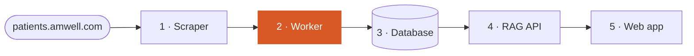
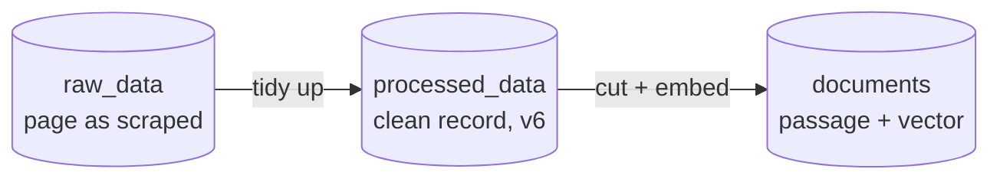

# Medical Chatbot · Worker

**Station 2 of 5** in a data pipeline that turns public health-condition pages into the knowledge behind a chatbot.

▶ **See it explained, with a 3D walkthrough, a meaning map and real records:** [medicalchatbot.demos.davieldev.com/worker](https://medicalchatbot.demos.davieldev.com/worker)



It tidies each scraped page into a clean record, cuts it into short passages and turns every passage into 384 numbers that capture its meaning, so the chatbot can search by meaning instead of by keyword.



## Quick start

```bash
make install
make test                                   # processing and chunking rules, offline
make run                                    # process what is new, then embed what has no passages yet
make run ARGS='--condition acid-reflux-gerd'
make run ARGS='--condition Acne --reembed'  # rebuild one condition's passages
```

Without make: `uv run python main.py --help`. It needs the shared Postgres from the [API](https://github.com/davidsanbric-dev/MedicalChatbotAPI) (`make db-up` there) and pages from the [scraper](https://github.com/davidsanbric-dev/MedicalChatbotScraper).

| Option | What it does |
| --- | --- |
| `--condition NAME` | Only one condition, by page slug (`acid-reflux-gerd`) or by name (`"Acid reflux & GERD"`), any letter case |
| `--list-conditions` | The scraped conditions, slug and name side by side |
| `--reembed` | Rebuild passages that already exist, after changing the chunking rules or the embedding model |

## From the walkthrough to the code

| Step on the [worker page](https://medicalchatbot.demos.davieldev.com/worker) | Code |
| --- | --- |
| 1 · Tidy up | [`services/processing.py`](services/processing.py): `process_page()` merges related blocks, drops repeated lists and NFKC-normalizes the text. Compare a record [before and after](https://medicalchatbot.demos.davieldev.com/worker#stages) |
| 2 · Cut into passages | [`services/chunking.py`](services/chunking.py): `build_chunks()` makes one passage for the symptoms, one per paragraph and one per list. See the [chunk stats](https://medicalchatbot.demos.davieldev.com/worker#chunks) |
| 3 · Turn into numbers | [`services/embedding.py`](services/embedding.py): `BAAI/bge-small-en-v1.5` through fastembed (ONNX on CPU), the same model the API uses for questions |
| 4 · Similar meanings, close together | The meaning map on the page plots every passage by its vector |

[`pipeline.py`](pipeline.py) runs the two phases over the database, [`repositories/`](repositories/) holds one module per table, and [`main.py`](main.py) is the command line. The three `services/` modules have no database code, which keeps them easy to unit-test.

## Re-running is safe

- **Versioned processing.** Records made by the current `PROCESSOR_VERSION` (`v6`) are skipped. Bump the version after changing the rules: the next run replaces older records and their passages in one transaction.
- **Idempotent embedding.** Records that already have passages are skipped; `--reembed` swaps them atomically, so a run never leaves duplicates or a half-embedded record.
- **Exit status.** A run that fails to process or embed any record exits with status 1.

What the audit of this data found and fixed, with a before/after passage: [Audit & fixes](https://medicalchatbot.demos.davieldev.com/worker#fixes).

## Docker

```bash
make docker-build
make docker-run ARGS='--condition acne'
```

## The whole pipeline

| Station | Repository | Walkthrough |
| --- | --- | --- |
| 1 · Scraper | [MedicalChatbotScraper](https://github.com/davidsanbric-dev/MedicalChatbotScraper) | [/scraper](https://medicalchatbot.demos.davieldev.com/scraper) |
| 2 · Worker | **MedicalChatbotWorker** (this one) | [/worker](https://medicalchatbot.demos.davieldev.com/worker) |
| 3 · Database | [MedicalChatbotAPI](https://github.com/davidsanbric-dev/MedicalChatbotAPI) | [/database](https://medicalchatbot.demos.davieldev.com/database) |
| 4 · RAG API | [MedicalChatbotAPI](https://github.com/davidsanbric-dev/MedicalChatbotAPI) | [/api](https://medicalchatbot.demos.davieldev.com/api) |
| 5 · Web app | [MedicalChatbotWeb](https://github.com/davidsanbric-dev/MedicalChatbotWeb) | [/interface](https://medicalchatbot.demos.davieldev.com/interface) · [chat](https://medicalchatbot.demos.davieldev.com/chat) |

Educational demo: the content comes from a public telehealth site and is not medical advice.
